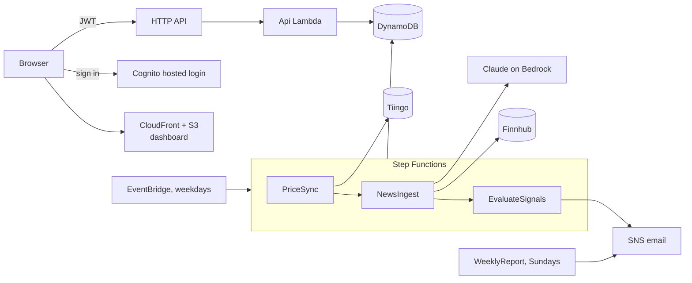

# Portfolio Tracker

Serverless stock/ETF tracker on AWS: a web dashboard, daily prices, AI news summaries (Claude on Bedrock), technical signals, and email alerts on rules you define.

> Describes data only. Not investment advice.

## Architecture



## API

All routes need `Authorization: Bearer <Cognito token>`.

| Route | Purpose |
|---|---|
| `GET/PUT/DELETE /holdings[/{ticker}]` | Manage holdings: `{"shares": 40, "cost_basis": 230}` |
| `GET /portfolio` | Value, gains, allocation, history vs. SPY |
| `GET /signals` | RSI, moving averages, drawdown, sentiment |
| `GET /news?ticker=VTI` | AI briefing and scored headlines |
| `GET/POST/DELETE /rules[/{ruleId}]`, `GET /rule-types` | Alert rules, e.g. `{"type": "drawdown_below", "ticker": "VTI", "params": {"pct": 10}}` |
| `GET /alerts` | Alert history |

## Setup

Needs the AWS CLI, Python 3.13+, Node 20+, free [Tiingo](https://www.tiingo.com/) and [Finnhub](https://finnhub.io/) keys, and access to Claude on Bedrock. Defaults target **us-east-2** with Claude Haiku 4.5 through the `us.` cross-region inference profile, so requests may be processed in us-east-1, us-east-2 or us-west-2.

```bash
make install && make test

# Store API keys (read -s keeps them out of shell history)
read -rs K && aws ssm put-parameter --name /portfolio-tracker/tiingo-api-key --type SecureString --value "$K"
read -rs K && aws ssm put-parameter --name /portfolio-tracker/finnhub-api-key --type SecureString --value "$K"; unset K

npx aws-cdk@2 bootstrap                      # once per account/region
make deploy ALERT_EMAIL=you@example.com      # then confirm the SNS emails
```

Create your user and call the API, using the stack outputs:

```bash
aws cognito-idp admin-create-user --user-pool-id $POOL --username you@example.com \
  --user-attributes Name=email,Value=you@example.com Name=email_verified,Value=true --message-action SUPPRESS
read -rs PW && aws cognito-idp admin-set-user-password --user-pool-id $POOL --username you@example.com --password "$PW" --permanent
TOKEN=$(aws cognito-idp initiate-auth --client-id $CLIENT --auth-flow USER_PASSWORD_AUTH \
  --auth-parameters USERNAME=you@example.com,PASSWORD="$PW" --query AuthenticationResult.IdToken --output text)
curl -X PUT "$API/holdings/VTI" -H "Authorization: Bearer $TOKEN" -d '{"shares": 40, "cost_basis": 230}'
```

Run the pipeline now: `aws stepfunctions start-execution --state-machine-arn <PipelineArn>`.

**Dashboard:** open the `DashboardUrl` output and sign in with the same email and password. It has Overview, Holdings, News & signals, and Alerts (create and delete rules). The code is plain HTML/CSS/JS in `web/` and is uploaded on every deploy.

## Configuration (`cdk.json` or `-c key=value`)

| Key | Default | Purpose |
|---|---|---|
| `alertEmail` | none | Alerts, reports, alarms, budget warnings |
| `allowedOrigins` | `localhost:5173` | CORS origins |
| `benchmarkTicker` | `SPY` | Performance benchmark |
| `bedrockModelId` | `us.anthropic.claude-haiku-4-5-20251001-v1:0` | Model for news summaries |
| `bedrockApi` | `runtime` | `runtime` for Haiku 4.5; `mantle` for newer models such as `anthropic.claude-haiku-5-5` once your account has access |
| `monthlyBudgetUsd` | `5` | Budget alert threshold |
| `useCustomerManagedKey` | `false` | Use your own KMS key (about $1/month) instead of AWS default encryption |

## Cost

About **$0–2/month** for one user: mostly free tier, plus a few cents of Bedrock and DynamoDB. A customer-managed key adds about $1/month for as long as it exists. It's kept if you switch the flag off; delete it with `aws kms schedule-key-deletion --key-id alias/portfolio-tracker --pending-window-in-days 30` once nothing needs it.

## Security

Encryption at rest everywhere, least-privilege role per function, Cognito hosted login (OAuth code + PKCE), private S3 behind CloudFront with a strict CSP and security headers, Cognito JWT on every route, API throttling and access logs, PITR and deletion protection, and API keys in SSM SecureString. CI runs Ruff with Bandit rules, `pip-audit`, cdk-nag, and template security tests, and deploys via OIDC. Details: [docs/SECURITY.md](docs/SECURITY.md).

## Layout

```
infra/          CDK stack and documented cdk-nag exceptions
web/            Dashboard (no build step)
src/portfolio/  Lambda handlers, providers, indicators, rules, analytics, LLM client
tests/          Unit, handler and infrastructure tests
```

## Roadmap

Rule backtesting, transaction history, and a custom domain for the dashboard.
