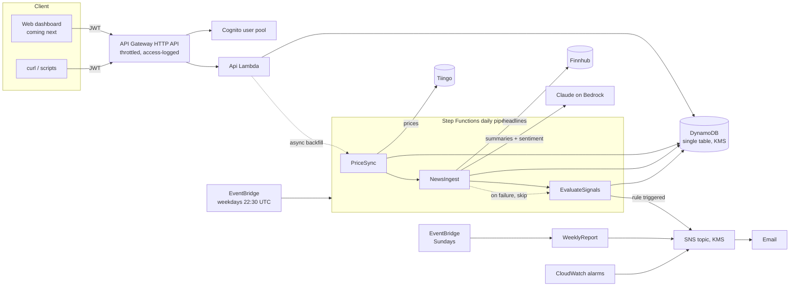

# Portfolio Tracker

A serverless stock and ETF portfolio tracker on AWS. It tracks your holdings, syncs prices every weekday, summarizes the day's news with Claude on Amazon Bedrock, computes technical signals, and emails you when rules you define are met.

> It describes data. It does not tell you what to buy or sell, and nothing it produces is investment advice.

## Architecture



| Piece | What it does |
|---|---|
| `Api` Lambda | REST API for holdings, rules, alerts, portfolio analytics, signals and news |
| `PriceSync` | Loads daily adjusted closes; backfills 5 years the first time a ticker appears |
| `NewsIngest` | Pulls recent headlines, scores sentiment and writes a short summary per ticker with Claude |
| `EvaluateSignals` | Computes RSI, 50/200-day averages, drawdown and sentiment; evaluates rules; emails on new triggers |
| `WeeklyReport` | Sunday email with the week's change, best and worst holdings, and alerts |

### API

All routes require a Cognito access or ID token in `Authorization: Bearer <token>`.

| Method and path | Purpose |
|---|---|
| `GET /holdings` | List your holdings |
| `PUT /holdings/{ticker}` | Add or update a holding: `{"shares": 40, "cost_basis": 230, "purchased_on": "2024-03-01"}` |
| `DELETE /holdings/{ticker}` | Remove a holding |
| `GET /portfolio` | Value, gains, allocation, value history and benchmark comparison |
| `GET /signals` | Latest signal snapshot per holding |
| `GET /news?ticker=VTI` | AI briefing and scored headlines (omit `ticker` for the whole portfolio) |
| `GET /rule-types` | Available alert rules and their parameters |
| `GET /rules` / `POST /rules` / `DELETE /rules/{ruleId}` | Manage alert rules |
| `GET /alerts` | Alert history |

Rule example: `{"type": "drawdown_below", "ticker": "VTI", "params": {"pct": 10}}`. Rule types: `price_below_sma`, `price_above_sma`, `golden_cross`, `death_cross`, `drawdown_below`, `rsi_below`, `rsi_above`, `weight_above`, `sentiment_below`.

## Security

Security is enforced in code and checked on every build. Highlights:

- **Encryption:** one customer-managed KMS key with automatic rotation encrypts the table, SNS topic, dead-letter queue, Lambda environment variables and every log group. SNS and SQS reject non-TLS requests.
- **Least privilege:** each Lambda has its own role with only what it needs. Bedrock access is limited to `bedrock-mantle:CreateInference` for a single model ID. Each function can read only its own API-key parameter.
- **Authentication:** Cognito with self sign-up disabled, a 12-character password policy, optional TOTP MFA, short-lived tokens, token revocation, and no user-existence leaks. Every API route requires a JWT.
- **Isolation and validation:** the user ID always comes from the verified token, never the request. Inputs are validated (ticker format, numeric ranges, body size, rule parameters), and per-user limits cap holdings and rules.
- **Secrets:** data-provider API keys are SSM SecureStrings and are never stored in code, environment variables or logs.
- **Abuse limits:** API throttling at 10 requests/s (burst 20), plus a monthly AWS Budget alert.
- **Data safety:** point-in-time recovery, deletion protection, and the table and user pool are retained if the stack is deleted.
- **Observability:** API access logs, JSON Lambda logs, X-Ray tracing, Step Functions logging, and alarms on errors, pipeline failures and the dead-letter queue.
- **LLM safety:** headlines are passed to Claude as tagged data, with instructions to ignore any commands inside them. Output is schema-validated, and the prompt forbids buy/sell advice.
- **Supply chain and CI:** Ruff with Bandit (`S`) rules, `pip-audit`, cdk-nag's AWS Solutions pack (synth fails on unsuppressed findings), tests that assert the security properties of the template, and GitHub Actions with read-only default permissions that deploys through OIDC with no stored AWS keys.

Every accepted cdk-nag exception is listed with its reason in [`infra/nag.py`](infra/nag.py). See [docs/SECURITY.md](docs/SECURITY.md) for the threat model and hardening options.

## Getting started

### Prerequisites

- An AWS account, with the AWS CLI configured (`aws sts get-caller-identity` works)
- Python 3.13+ and Node.js 20+
- Free API keys from [Tiingo](https://www.tiingo.com/) (prices) and [Finnhub](https://finnhub.io/) (news)
- Claude Haiku 5.5 available on Amazon Bedrock in your deployment region (check the Bedrock console). To use a different model, change `bedrockModelId` in `cdk.json`.

### 1. Install and test

```bash
make install
make test
```

### 2. Store the API keys as encrypted parameters

Keys are read with `read -s` so they never appear in your shell history:

```bash
read -rs TIINGO_KEY && aws ssm put-parameter --name /portfolio-tracker/tiingo-api-key --type SecureString --value "$TIINGO_KEY"
read -rs FINNHUB_KEY && aws ssm put-parameter --name /portfolio-tracker/finnhub-api-key --type SecureString --value "$FINNHUB_KEY"
unset TIINGO_KEY FINNHUB_KEY
```

### 3. Deploy

```bash
npx aws-cdk@2 bootstrap                 # once per account and region
make deploy ALERT_EMAIL=you@example.com
```

Then confirm the SNS subscription email AWS sends you. Stack outputs include `ApiUrl`, `UserPoolId` and `UserPoolClientId`.

### 4. Create your user and call the API

```bash
POOL=<UserPoolId>; CLIENT=<UserPoolClientId>; API=<ApiUrl>
aws cognito-idp admin-create-user --user-pool-id $POOL --username you@example.com \
  --user-attributes Name=email,Value=you@example.com Name=email_verified,Value=true --message-action SUPPRESS
read -rs PW && aws cognito-idp admin-set-user-password --user-pool-id $POOL --username you@example.com --password "$PW" --permanent

TOKEN=$(aws cognito-idp initiate-auth --client-id $CLIENT --auth-flow USER_PASSWORD_AUTH \
  --auth-parameters USERNAME=you@example.com,PASSWORD="$PW" --query AuthenticationResult.IdToken --output text)

curl -X PUT "$API/holdings/VTI" -H "Authorization: Bearer $TOKEN" -H "Content-Type: application/json" \
  -d '{"shares": 40, "cost_basis": 230}'
curl "$API/portfolio" -H "Authorization: Bearer $TOKEN"
```

To run the pipeline now instead of waiting for the evening schedule:

```bash
aws stepfunctions start-execution --state-machine-arn <PipelineArn>
```

## Configuration

Set these in `cdk.json` context or with `-c key=value`:

| Key | Default | Purpose |
|---|---|---|
| `alertEmail` | none | Receives alerts, weekly reports, alarms and budget warnings |
| `allowedOrigins` | `["http://localhost:5173"]` | CORS origins for the web app |
| `benchmarkTicker` | `SPY` | Benchmark for performance comparison |
| `bedrockModelId` | `anthropic.claude-haiku-5-5` | Claude model used for news summaries |
| `monthlyBudgetUsd` | `5` | AWS Budget alert threshold |

## Cost

At personal scale (one user, a handful of tickers), expect about **$1–3/month**:

| Service | Approx. monthly |
|---|---|
| KMS customer-managed key | $1.00 |
| Bedrock (Claude Haiku 5.5, about 6 small calls per weekday) | well under $0.50 |
| Lambda, Step Functions, EventBridge, SNS email, API Gateway | cents, mostly free tier |
| DynamoDB on-demand + PITR | cents |
| CloudWatch logs and alarms | the first 10 alarms are free; logs are tiny |

Tiingo and Finnhub free tiers cover this usage.

## Design decisions

- **Single-table DynamoDB:** every access pattern is a key or prefix query, with no scans. The key layout is documented in [`src/portfolio/db.py`](src/portfolio/db.py).
- **One API Lambda with a router** instead of one function per route: fewer cold starts and one place for auth and validation.
- **Step Functions for the daily pipeline** gives retries per step, and a news failure doesn't block signals and alerts.
- **Edge-triggered alerts:** an email goes out when a rule changes from not met to met, not every day it stays true.
- **Pure-Python indicators** (`indicators.py`) with no pandas or numpy keep the deployment small and the math unit-testable.
- **Standard-library HTTP** for the data providers, and the Anthropic SDK (Bedrock Mantle client) for Claude with structured outputs.

## Project layout

```
app.py                    CDK entry point (runs cdk-nag)
infra/stack.py            All AWS resources
infra/nag.py              Documented cdk-nag exceptions
src/portfolio/            Lambda code: handlers/, providers/, db, indicators, rules, analytics, llm
tests/                    pytest suites, including infrastructure security assertions
scripts/build_layer.sh    Builds the arm64 dependency layer without Docker
.github/workflows/ci.yml  Lint, test, audit, synth; manual OIDC deploy
```

## Roadmap

- Web dashboard (S3 + CloudFront with Origin Access Control and security headers), using the dark theme from the mockups
- Rule backtesting against price history
- Transaction-level history (buys and sells) for exact performance
