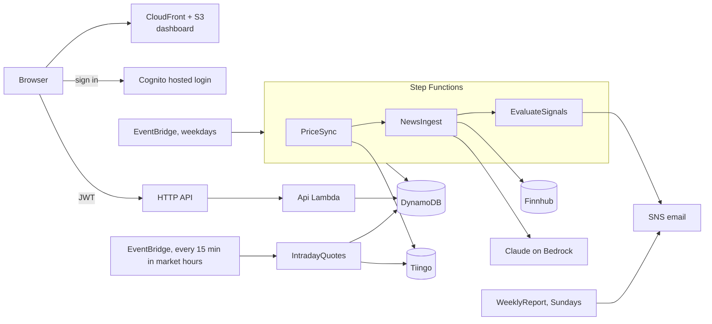

# Portfolio Tracker

Serverless stock/ETF tracker on AWS: a web dashboard, daily prices, AI news summaries (Claude on Bedrock), technical signals, and email alerts on rules you define.

> Describes data only. Not investment advice.

## Architecture



## API

All routes need `Authorization: Bearer <Cognito token>`.

| Route | Purpose |
|---|---|
| `GET /holdings[?group=…]` | List holdings (each has a `group`: `stocks`, `auto`, `partner_stocks` or `partner_auto`) |
| `PUT/DELETE /groups/{group}/holdings/{ticker}` | Set or remove a holding in a group: `{"shares": 40, "avg_cost": 230}` (average per share; the old name `cost_basis` is still accepted) or `{"shares": 40, "total_cost": 9200}` (total invested) |
| `POST /groups/{group}/holdings/{ticker}/purchases` | Record a buy: `{"shares": 5, "price": 280}` or `{"shares": 0.28, "amount": 200}`. Updates that group's total shares and weighted average cost |
| `GET /profile` | Display names (`owner_name`, `partner_name`) and whether to show the partner page |
| `GET /portfolio` | Value, gains, allocation, history and 1Y return, under `portfolios.<household\|mine\|partner>.<overall\|stocks\|auto>`. During market hours values use intraday prices (`live_as_of` is the quote time, otherwise null); history stays on closing prices. The Overview re-fetches every 15 minutes while open and visible |
| `GET /signals` | RSI, moving averages, drawdown, sentiment, and 3M/6M/YTD/1Y/3Y-per-year total returns by calendar date |
| `GET /news?ticker=VTI` | AI briefing and scored headlines (held or watched tickers) |
| `GET/POST/DELETE /rules[/{ruleId}]`, `GET /rule-types` | Alert rules, e.g. `{"type": "drawdown_below", "ticker": "VTI", "params": {"pct": 10}}` |
| `GET /alerts` | Alert history |
| `GET/POST /groups/{group}/holdings/{ticker}/transactions`, `PUT/DELETE …/{txnId}`, `GET /realized` | Stock Holdings: each buy and sale (first-in, first-out); the holding is the replayed total; realized gains by year, long vs. short term |
| `GET /checkup`, `GET/PUT /targets` | Mix by area vs. your own target mix, risk vs. the market (VTI); the first Saturday of each month a short email with a PDF report goes out through SES (`checkupModelId` writes the summary; the alert address must be a verified SES identity, otherwise it falls back to plain text) |
| `GET /watchlist`, `PUT/DELETE /watchlist/{ticker}` | Tickers you follow but don't hold (up to 10): signals, live price and news, never in totals. Removing one you don't hold deletes its rules |

## Setup

Needs the AWS CLI, Python 3.13+, Node 20+, free [Tiingo](https://www.tiingo.com/) and [Finnhub](https://finnhub.io/) keys, and access to Claude on Bedrock. Defaults target **us-east-2** with Claude Haiku 4.5 through the `us.` cross-region inference profile, so requests may be processed in us-east-1, us-east-2 or us-west-2.

```bash
make install && make test

# Store API keys (read -s keeps them out of shell history)
read -rs K && aws ssm put-parameter --name /portfolio-tracker/tiingo-api-key --type SecureString --value "$K"
read -rs K && aws ssm put-parameter --name /portfolio-tracker/finnhub-api-key --type SecureString --value "$K"; unset K

npx aws-cdk@2 bootstrap                      # once per account/region
make deploy ALERT_EMAIL=you@example.com      # then confirm the SNS emails
```

**Auto-deploy (optional):** with `githubDeploy` on, deploy once, then add a `production` environment (branch `main` only) with secrets `AWS_DEPLOY_ROLE_ARN` (stack output), `ALERT_EMAIL`, `OWNER_NAME`, `PARTNER_NAME`. Merges to `main` then deploy, except docs/tests/CI-only changes.

Create your user and call the API, using the stack outputs:

```bash
aws cognito-idp admin-create-user --user-pool-id $POOL --username you@example.com \
  --user-attributes Name=email,Value=you@example.com Name=email_verified,Value=true --message-action SUPPRESS
read -rs PW && aws cognito-idp admin-set-user-password --user-pool-id $POOL --username you@example.com --password "$PW" --permanent
TOKEN=$(aws cognito-idp initiate-auth --client-id $CLIENT --auth-flow USER_PASSWORD_AUTH \
  --auth-parameters USERNAME=you@example.com,PASSWORD="$PW" --query AuthenticationResult.IdToken --output text)
curl -X PUT "$API/holdings/VTI" -H "Authorization: Bearer $TOKEN" -d '{"shares": 40, "avg_cost": 230}'
```

Run the pipeline now: `aws stepfunctions start-execution --state-machine-arn <PipelineArn>`.

**Dashboard:** open the `DashboardUrl` output and sign in with the same email and password. To skip the password next time, choose **Add passkey** (top right) once on each device and approve with Touch ID or Face ID. Each person can add their own; the password stays as a backup. Passkeys belong to the Cognito login domain, so a future custom domain means adding them again. The sign-in page's look (dark colours and background image) lives in `infra/login/`. To install it on a phone: Safari → Share → **Add to Home Screen**, or Chrome → **Install app**. It has Overview, a portfolio page per person (yours, plus an optional partner's such as a spouse's, each with Stock Holdings and Automatic Investment tabs), News & signals, and Alerts. Overview switches between Household and each person, with a Stock Holdings / Automatic Investment / Total table. A ticker can be held in several groups; each keeps its own shares and average cost, and totals combine them. The 40-ticker limit counts unique tickers across all groups, and `weight_above` rules use the household total. The code is plain HTML/CSS/JS in `web/` and is uploaded on every deploy.

## Configuration (`cdk.json` or `-c key=value`)

| Key | Default | Purpose |
|---|---|---|
| `alertEmail` | none | Alerts, reports, alarms, budget warnings |
| `allowedOrigins` | `localhost:5173` | CORS origins |
| `ownerName` / `partnerName` | none | Names on the portfolio pages and weekly email, e.g. `-c ownerName=Alex -c partnerName=Sam` (or `make deploy OWNER_NAME=Alex PARTNER_NAME=Sam`); the partner page appears only when `partnerName` is set. Pass them at deploy time rather than committing them; they're served only to signed-in users |
| `allowedCountries` | `[]` (this repo's cdk.json: `["US"]`) | Countries that can load the dashboard's pages (CloudFront geo restriction); `[]` allows all. Not the API or sign-in |
| `newsExcludedTickers` | `["ITOT", "MGV", "DGRO", "DVY", "IWB", "ONEQ", "SPYD"]` | Tickers to skip when fetching news (e.g. broad index funds with no headlines); price signals still apply |
| `intradayQuotes` | `true` | Fetch intraday prices every 15 minutes while the US market is open (one Tiingo request for all tickers, about 27 a day). `false` shows closing prices only |
| `partnerNews` | `true` (this repo's `cdk.json`: `false`) | `false` skips news for the partner's tickers unless the owner also holds them. Price signals and price-based alerts still apply; `sentiment_below` rules on those tickers can't fire |
| `bedrockModelId` | `us.anthropic.claude-haiku-4-5-20251001-v1:0` | Model for news summaries |
| `bedrockApi` | `runtime` | `runtime` for Haiku 4.5; `mantle` for newer models such as `anthropic.claude-haiku-5-5` once your account has access |
| `monthlyBudgetUsd` | `5` | Whole-account budget alert threshold; `0` skips it (e.g. if the account already has a budget) |
| `accessAnalyzer` | `false` (this repo's `cdk.json`: `true`) | Free IAM Access Analyzer that flags resources reachable from outside the account and emails new findings to `alertEmail`. Only one is allowed per account and region, so check first with `aws accessanalyzer list-analyzers --type ACCOUNT` |
| `guardDuty` | `false` | GuardDuty threat detection (about $1–4/month after a 30-day trial); emails severity 4+ findings to `alertEmail`. One per region: check with `aws guardduty list-detectors` |
| `githubDeploy` / `githubRepo` | `false` / none (this repo: `true` / its own) | Keyless GitHub deploy role, usable only from this repo's `production` environment. `githubRepo` is the `sub_claim_prefix` from `gh api repos/OWNER/REPO/actions/oidc/customization/sub`, without `repo:` |
| `useCustomerManagedKey` | `false` | Use your own KMS key (about $1/month) instead of AWS default encryption |

## Commits

PR titles follow [Conventional Commits](https://www.conventionalcommits.org/en/v1.0.0/) (`feat:`, `fix(api):`, `chore:`, …) and are checked in CI. The repo allows squash merges only, with the PR title as the commit title, so `main` stays in that format.

## Cost

About **$0–2/month** for one user: mostly free tier, plus a few cents of Bedrock and DynamoDB. A customer-managed key adds about $1/month for as long as it exists. It's kept if you switch the flag off; delete it with `aws kms schedule-key-deletion --key-id alias/portfolio-tracker --pending-window-in-days 30` once nothing needs it.

## Security

Encryption at rest everywhere, least-privilege role per function, Cognito hosted login (OAuth code + PKCE), private S3 behind CloudFront with a strict CSP and security headers, Cognito JWT on every route, API throttling and access logs, PITR and deletion protection, and API keys in SSM SecureString. CI runs Ruff with Bandit rules, actionlint and zizmor on the workflows, `pip-audit` (also weekly), dependency review, cdk-nag, and template security tests, then deploys via OIDC and smoke-tests the site and API. Details: [docs/SECURITY.md](docs/SECURITY.md).

## Layout

```
infra/          CDK stack and documented cdk-nag exceptions
web/            Dashboard (no build step)
src/portfolio/  Lambda handlers, providers, indicators, rules, analytics, LLM client
tests/          Unit, handler and infrastructure tests
```

## Roadmap

See [docs/ROADMAP.md](docs/ROADMAP.md): transactions and sales, dividends, allocation targets, a watchlist, intraday alerts and more.

## License

[MIT](LICENSE)
